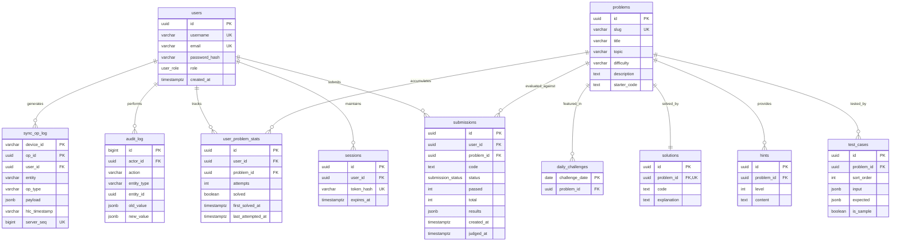

# Entity-Relationship (ER) Diagram & Data Modelling (Section 2.B)

## 1. Entity Catalog & Attributes

The database comprises 11 distinct entities designed to model the complete lifecycle of DSA problem discovery, submission execution, stats tracking, security, and distributed synchronization:

### 1.1 `users`
Represents registered users and administrators on the platform.
- `id` (`UUID`, PK): Unique identifier, generated via `gen_random_uuid()`.
- `username` (`VARCHAR(50)`, UNIQUE, NOT NULL): User handle with `CHECK (length(username) >= 3)`.
- `email` (`VARCHAR(255)`, UNIQUE, NOT NULL): Validated email format via regex `CHECK`.
- `password_hash` (`VARCHAR(255)`, NOT NULL): Salted bcrypt password hash.
- `role` (`user_role` ENUM, NOT NULL): Role for RBAC (`'user'` or `'admin'`).
- `created_at` (`TIMESTAMPTZ`, NOT NULL): Registration timestamp.
- `updated_at` (`TIMESTAMPTZ`, NOT NULL): Profile modification timestamp.

### 1.2 `sessions`
Tracks active user authentication sessions and refresh tokens.
- `id` (`UUID`, PK): Session identifier.
- `user_id` (`UUID`, FK $\rightarrow$ `users.id`, NOT NULL): Owning user.
- `token_hash` (`VARCHAR(64)`, UNIQUE, NOT NULL): SHA-256 hash of refresh token.
- `expires_at` (`TIMESTAMPTZ`, NOT NULL): Session expiration deadline.
- `ip_address` (`VARCHAR(45)`): IPv4 or IPv6 client origin.
- `user_agent` (`TEXT`): Client browser / operating system identifier.
- `created_at` (`TIMESTAMPTZ`, NOT NULL): Session creation timestamp.

### 1.3 `problems`
The core DSA problem entity.
- `id` (`UUID`, PK): Problem identifier.
- `slug` (`VARCHAR(100)`, UNIQUE, NOT NULL): URL-friendly unique identifier (e.g., `'two-sum'`).
- `title` (`VARCHAR(255)`, NOT NULL): Human-readable problem title.
- `topic` (`VARCHAR(50)`, NOT NULL): Category (`'Arrays'`, `'Strings'`, `'LinkedList'`, `'Trees'`, `'Graphs'`, `'Dynamic Programming'`, `'Sorting'`, `'Searching'`).
- `difficulty` (`VARCHAR(20)`, NOT NULL): `CHECK (difficulty IN ('Easy', 'Medium', 'Hard'))`.
- `description` (`TEXT`, NOT NULL): Markdown formatted problem specification.
- `starter_code` (`TEXT`, NOT NULL): Language-specific starter function template.
- `is_published` (`BOOLEAN`, NOT NULL, DEFAULT true): Publication visibility flag.
- `created_at` (`TIMESTAMPTZ`, NOT NULL): Problem creation timestamp.
- `updated_at` (`TIMESTAMPTZ`, NOT NULL): Problem last edit timestamp.

### 1.4 `test_cases`
Input and expected output pairs for code evaluation.
- `id` (`UUID`, PK): Test case identifier.
- `problem_id` (`UUID`, FK $\rightarrow$ `problems.id`, NOT NULL): Target problem.
- `sort_order` (`INT`, NOT NULL): Ordering sequence for display and testing.
- `input` (`JSONB`, NOT NULL): Serialized input parameters.
- `expected` (`JSONB`, NOT NULL): Expected evaluation return value.
- `is_sample` (`BOOLEAN`, NOT NULL, DEFAULT false): Whether visible in problem description as an example.
- `created_at` (`TIMESTAMPTZ`, NOT NULL): Timestamp.

### 1.5 `hints`
Progressive hints unlocked during problem solving.
- `id` (`UUID`, PK): Hint identifier.
- `problem_id` (`UUID`, FK $\rightarrow$ `problems.id`, NOT NULL): Target problem.
- `level` (`INT`, NOT NULL): Progressive hint level ($1, 2, 3\dots$) with `CHECK (level >= 1)`.
- `content` (`TEXT`, NOT NULL): Markdown hint guidance.
- `created_at` (`TIMESTAMPTZ`, NOT NULL): Timestamp.

### 1.6 `solutions`
Official verified reference solutions.
- `id` (`UUID`, PK): Solution identifier.
- `problem_id` (`UUID`, FK $\rightarrow$ `problems.id`, UNIQUE, NOT NULL): 1:1 relation to parent problem.
- `code` (`TEXT`, NOT NULL): Canonical reference code.
- `explanation` (`TEXT`): Time and space complexity breakdown ($O(N)$, $O(1)$) and algorithm notes.
- `created_at` (`TIMESTAMPTZ`, NOT NULL): Timestamp.

### 1.7 `daily_challenges`
Tracks the featured DSA problem of the day.
- `challenge_date` (`DATE`, PK): Date of the challenge (`CURRENT_DATE`).
- `problem_id` (`UUID`, FK $\rightarrow$ `problems.id`, NOT NULL): Selected problem.
- `created_at` (`TIMESTAMPTZ`, NOT NULL): Scheduling timestamp.

### 1.8 `submissions`
Transactional history of user code submissions.
- `id` (`UUID`, PK): Unique submission identifier.
- `user_id` (`UUID`, FK $\rightarrow$ `users.id`, NOT NULL): Submitting user.
- `problem_id` (`UUID`, FK $\rightarrow$ `problems.id`, NOT NULL): Submitted problem.
- `code` (`TEXT`, NOT NULL): Exact source code submitted.
- `status` (`submission_status` ENUM, NOT NULL): `'queued' | 'running' | 'judged' | 'failed'`.
- `passed` (`INT`, DEFAULT 0): Denormalized count of passed test cases.
- `total` (`INT`, DEFAULT 0): Denormalized total test cases executed.
- `results` (`JSONB`): Array of per-testcase results (`passed`, `actual`, `expected`, `runtimeMs`, `error`).
- `created_at` (`TIMESTAMPTZ`, NOT NULL): Queued timestamp.
- `judged_at` (`TIMESTAMPTZ`): Execution completion timestamp.

### 1.9 `user_problem_stats`
Associative progression state resolving the N:M relationship between `users` and `problems`.
- `id` (`UUID`, PK): Stats identifier.
- `user_id` (`UUID`, FK $\rightarrow$ `users.id`, NOT NULL): User.
- `problem_id` (`UUID`, FK $\rightarrow$ `problems.id`, NOT NULL): Problem.
- `attempts` (`INT`, NOT NULL, DEFAULT 1): Total attempts by user on this problem.
- `solved` (`BOOLEAN`, NOT NULL, DEFAULT false): Whether successfully solved at least once.
- `first_solved_at` (`TIMESTAMPTZ`): Timestamp of first $100\%$ pass.
- `last_attempted_at` (`TIMESTAMPTZ`, NOT NULL): Most recent submission attempt.

### 1.10 `audit_log`
Immutable, tamper-proof administrative log.
- `id` (`BIGINT`, GENERATED ALWAYS AS IDENTITY, PK): Monotonic sequence ID.
- `actor_id` (`UUID`, FK $\rightarrow$ `users.id`): Administrator who performed the action.
- `action` (`VARCHAR(100)`, NOT NULL): Action identifier (e.g., `'PROBLEM_UPDATE'`).
- `entity_type` (`VARCHAR(50)`, NOT NULL): Entity modified (`'Problem'`, `'TestCase'`).
- `entity_id` (`UUID`, NOT NULL): Primary key of the affected entity.
- `old_value` (`JSONB`): Pre-modification snapshot.
- `new_value` (`JSONB`): Post-modification snapshot.
- `ip_address` (`VARCHAR(45)`): Client network origin.
- `created_at` (`TIMESTAMPTZ`, NOT NULL): Event timestamp.

### 1.11 `sync_op_log`
Distributed operation log for offline-first replication.
- `device_id` (`VARCHAR(64)`, NOT NULL): Physical client device identifier.
- `op_id` (`UUID`, NOT NULL): Client-generated operation UUID.
- `user_id` (`UUID`, FK $\rightarrow$ `users.id`, NOT NULL): User context.
- `entity` (`VARCHAR(50)`, NOT NULL): Entity type (`'submission'`, `'settings'`, `'stats'`).
- `op_type` (`VARCHAR(20)`, NOT NULL): `'INSERT' | 'UPDATE' | 'DELETE'`.
- `payload` (`JSONB`, NOT NULL): Operation data payload.
- `client_time` (`TIMESTAMPTZ`, NOT NULL): Client wall clock.
- `hlc_timestamp` (`VARCHAR(64)`, NOT NULL): Hybrid Logical Clock timestamp.
- `server_seq` (`BIGINT`, GENERATED ALWAYS AS IDENTITY): Monotonic server sequence cursor.

---

## 2. Primary Keys & Foreign Keys Summary

| Entity | Primary Key | Foreign Keys (FK) & Target | On Delete Behavior |
| :--- | :--- | :--- | :--- |
| `users` | `id` | None | N/A |
| `sessions` | `id` | `user_id` $\rightarrow$ `users(id)` | `CASCADE` |
| `problems` | `id` | None | N/A |
| `test_cases` | `id` | `problem_id` $\rightarrow$ `problems(id)` | `CASCADE` |
| `hints` | `id` | `problem_id` $\rightarrow$ `problems(id)` | `CASCADE` |
| `solutions` | `id` | `problem_id` $\rightarrow$ `problems(id)` | `CASCADE` |
| `daily_challenges` | `challenge_date` | `problem_id` $\rightarrow$ `problems(id)` | `CASCADE` |
| `submissions` | `id` | `user_id` $\rightarrow$ `users(id)`, `problem_id` $\rightarrow$ `problems(id)` | `CASCADE` |
| `user_problem_stats` | `id` | `user_id` $\rightarrow$ `users(id)`, `problem_id` $\rightarrow$ `problems(id)` | `CASCADE` |
| `audit_log` | `id` | `actor_id` $\rightarrow$ `users(id)` | `SET NULL` |
| `sync_op_log` | `(device_id, op_id)` | `user_id` $\rightarrow$ `users(id)` | `CASCADE` |

---

## 3. Cardinality & Relationship Representation

1. **One-to-One (1:1)**:
   - `problems` $\leftrightarrow$ `solutions`: Each problem has exactly one official reference solution enforced via `UNIQUE (problem_id)` in the `solutions` table.
2. **One-to-Many (1:N)**:
   - `problems` $\rightarrow$ `test_cases`: One problem owns many test cases ordered by `sort_order`.
   - `problems` $\rightarrow$ `hints`: One problem owns multiple sequential hints ordered by `level`.
   - `users` $\rightarrow$ `sessions`: One user can maintain multiple active login sessions across devices.
   - `users` $\rightarrow$ `submissions`: One user creates multiple submission records over time.
   - `problems` $\rightarrow$ `submissions`: One problem receives submissions from various users.
3. **Many-to-Many (N:M)**:
   - `users` $\leftrightarrow$ `problems`: A user attempts multiple problems; a problem is attempted by multiple users. This relationship is modeled through two associative paths:
     - Detailed granular transactional history: via `submissions`.
     - Fast aggregated progression state: via `user_problem_stats` with `UNIQUE (user_id, problem_id)`.

---

## 4. Entity-Relationship (ER) Diagram

