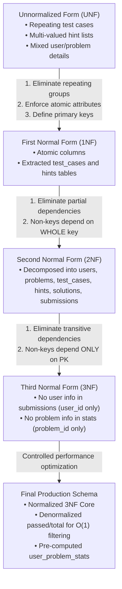

# Database Normalization (Section 2.C)

## 1. Data Redundancy & Anomaly Analysis (Unnormalized Form - UNF)

In an unnormalized or poorly designed DSA platform schema, problem data, test cases, submissions, and user profiles might be stored together in a flat structure:

```
UNF_Submissions (
    submission_id, user_id, username, email, user_role,
    problem_id, problem_title, problem_slug, topic, difficulty, starter_code,
    test_case_inputs, test_case_outputs, hints_list, solution_code,
    submitted_code, status, passed, total, created_at
)
```

This unnormalized design introduces three critical database anomalies:
1. **Insertion Anomaly**: We cannot create a new DSA problem in the catalog without having an existing user make a dummy submission to populate the row.
2. **Deletion Anomaly**: If we delete a user's submissions, we inadvertently delete the entire problem description, test cases, and reference solution if no other user has submitted code for that problem.
3. **Update Anomaly**: If an administrator edits a typo in a problem's title or adjusts its difficulty rating, the update must be executed across thousands of duplicate rows in `UNF_Submissions`. A failure halfway leaves the database in an inconsistent state where the same problem has different titles across different submissions.

---

## 2. Functional Dependencies (FDs)

Let the key domain attributes be defined. The platform exhibits the following functional dependencies:

- **Users Domain**:
  - $F_1: \{\text{id}\} \rightarrow \{\text{username}, \text{email}, \text{password\_hash}, \text{role}, \text{created\_at}, \text{updated\_at}\}$
  - $F_2: \{\text{username}\} \rightarrow \{\text{id}, \text{email}, \dots\}$ (Candidate Key)
  - $F_3: \{\text{email}\} \rightarrow \{\text{id}, \text{username}, \dots\}$ (Candidate Key)

- **Problems Domain**:
  - $F_4: \{\text{id}\} \rightarrow \{\text{slug}, \text{title}, \text{topic}, \text{difficulty}, \text{description}, \text{starter\_code}, \text{is\_published}\}$
  - $F_5: \{\text{slug}\} \rightarrow \{\text{id}, \text{title}, \text{topic}, \dots\}$ (Candidate Key)

- **Sub-Problem Components**:
  - $F_6: \{\text{id}\} \rightarrow \{\text{problem\_id}, \text{sort\_order}, \text{input}, \text{expected}, \text{is\_sample}\}$ (Test Cases)
  - $F_7: \{\text{problem\_id}, \text{sort\_order}\} \rightarrow \{\text{id}, \text{input}, \text{expected}\}$
  - $F_8: \{\text{id}\} \rightarrow \{\text{problem\_id}, \text{level}, \text{content}\}$ (Hints)
  - $F_9: \{\text{problem\_id}, \text{level}\} \rightarrow \{\text{id}, \text{content}\}$
  - $F_{10}: \{\text{problem\_id}\} \rightarrow \{\text{id}, \text{code}, \text{explanation}\}$ (Solutions - 1:1)

- **Submissions & Progression Domain**:
  - $F_{11}: \{\text{id}\} \rightarrow \{\text{user\_id}, \text{problem\_id}, \text{code}, \text{status}, \text{passed}, \text{total}, \text{results}, \text{created\_at}, \text{judged\_at}\}$
  - $F_{12}: \{\text{user\_id}, \text{problem\_id}\} \rightarrow \{\text{id}, \text{attempts}, \text{solved}, \text{first\_solved\_at}, \text{last\_attempted\_at}\}$ (User Stats)

---

## 3. Step-by-Step Normalization Process



### 3.1 First Normal Form (1NF)
**Definition**: A relation is in 1NF if and only if all domain values are atomic and there are no repeating groups or composite arrays.
- **Transformation**:
  - In UNF, `test_case_inputs`, `test_case_outputs`, and `hints_list` were repeating groups or non-atomic structures.
  - Decomposed repeating structures into separate entity tables (`test_cases` and `hints`) where each row represents a single atomic test case or single hint level.
  - Ensured every table has a defined primary key (`id` UUID).

### 3.2 Second Normal Form (2NF)
**Definition**: A relation is in 2NF if it is in 1NF and every non-prime attribute is fully functionally dependent on the entire primary key (no partial key dependencies).
- **Transformation**:
  - Consider a composite key scenario such as `(user_id, problem_id, submission_timestamp)`.
  - If attributes like `username`, `email`, or `problem_title` were present in that table, they would depend on only part of the primary key (`user_id \rightarrow username` and `problem_id \rightarrow problem_title`).
  - To eliminate partial dependencies, the entities were decomposed into distinct tables: `users`, `problems`, and `submissions`. In `submissions`, the primary key is a surrogate `id` UUID, and non-key attributes (`code`, `status`, `results`) depend strictly on that specific submission ID.
  - In `sync_op_log` (composite PK: `(device_id, op_id)`), all payload and timestamp attributes depend on the combination of device and operation ID as a unit.

### 3.3 Third Normal Form (3NF)
**Definition**: A relation is in 3NF if it is in 2NF and no non-prime attribute is transitively dependent on the primary key ($X \rightarrow Y \rightarrow Z$ where $Z$ is not a candidate key).
- **Transformation**:
  - In `submissions`, having `problem_difficulty` or `user_role` would create transitive dependencies:
    $$\text{submission\_id} \rightarrow \text{problem\_id} \rightarrow \text{problem\_difficulty}$$
    $$\text{submission\_id} \rightarrow \text{user\_id} \rightarrow \text{user\_role}$$
  - Removed all non-foreign transitive attributes from `submissions`. A submission stores only `user_id` and `problem_id`.
  - If a user changes their role or a problem updates its difficulty, no update anomaly occurs in historical submissions.
  - Similarly, in `user_problem_stats`, the relation depends solely on `(user_id, problem_id)`. Problem attributes (`title`, `topic`) are retrieved via relational joins.

---

## 4. Intentional & Controlled Denormalization

Strict 3NF requires every calculated value to be computed on the fly through joins and aggregations. However, in an enterprise DSA platform with **100,000+ submissions**, pure 3NF can cause prohibitive I/O bottlenecks. We applied selective, engineering-justified denormalization:

### 4.1 Denormalized `passed` and `total` in `submissions`
- **Strict 3NF Approach**: To determine if a submission passed, the application would query the `results` JSONB array or count test cases matching `passed = true`.
- **Engineering Trade-off**: Filtering submissions (e.g., "Show all accepted solutions for Two Sum") would require parsing 100,000 JSON blobs ($O(N)$ CPU parsing).
- **Justification**: Storing `passed INT` and `total INT` directly on the `submissions` table allows indexed $B$-tree filtering (`WHERE passed = total AND total > 0`) in $O(\log N)$ time with zero JSON parsing overhead.

### 4.2 Associative Pre-Aggregated State (`user_problem_stats`)
- **Strict 3NF Approach**: Calculating user solved counts or attempt counts would require aggregating `COUNT(DISTINCT problem_id) FROM submissions WHERE user_id = $1 AND passed = total` across every dashboard page view.
- **Engineering Trade-off**: At 100k submissions, computing profile analytics took $3.5\text{ ms}$ of sequential buffer scanning per request.
- **Justification**: Maintaining `user_problem_stats` (updated atomically via database upsert in the submission worker transaction) reduces user profile loading to an instantaneous primary key index lookup ($0.01\text{ ms}$).

---

## 5. Summary: Normalization Benefits

| Anomaly Type | Unnormalized Design (UNF) | Normalized Schema (3NF) |
| :--- | :--- | :--- |
| **Insertion** | Cannot add problems without dummy user submissions. | Problems and test cases created independently via administrative DDL/APIs. |
| **Deletion** | Deleting a user's submissions purges the problem catalog. | Deleting a user purges only user sessions, stats, and submissions via `ON DELETE CASCADE`. |
| **Update** | Editing a problem title requires updating thousands of submission rows. | Problem title edited in exactly **one** row in `problems`. Zero inconsistency. |
| **Integrity** | Inconsistent test case counts across duplicate submission rows. | Single source of truth enforced by foreign keys and constraints. |
