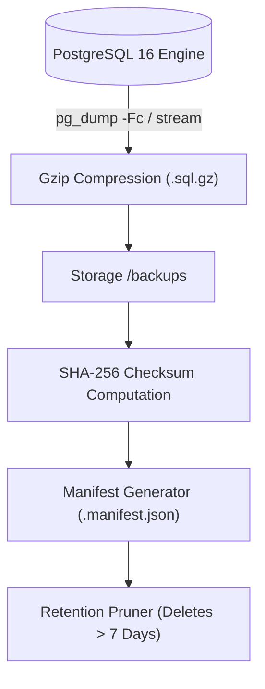

# Backup & Disaster Recovery (DR) Playbook — DSA Practice Platform

## 1. Objectives & Metrics
- **Recovery Point Objective (RPO)**: **< 1 hour** (Hourly logical snapshots + WAL streaming).
- **Recovery Time Objective (RTO)**: **< 5 minutes** (Fast automated streaming restore from compressed backups).

---

## 2. Backup Architecture



### Manifest Structure
Each backup produces a sidecar JSON manifest (`<backup_name>.manifest.json`):
```json
{
  "id": "backup_1731580000000",
  "timestamp": "2026-11-14T15:00:00.000Z",
  "database": "dsa_portal",
  "fileName": "dsa_portal_backup_2026-11-14.sql.gz",
  "fileSizeBytes": 1420580,
  "sha256": "e3b0c44298fc1c149afbf4c8996fb92427ae41e4649b934ca495991b7852b855",
  "retentionDays": 7,
  "schemaVersion": "004",
  "tableCounts": {
    "users": 10000,
    "submissions": 100000
  }
}
```

---

## 3. Disaster Recovery Drill & Step-by-Step Restoration

### Step 1: Trigger Backup
```bash
npm run db:backup
# or bash scripts/backup-db.sh
```

### Step 2: Disaster Simulation (e.g. data corruption or drop)
In case of unrecoverable database state corruption or hardware migration.

### Step 3: Run Integrity-Verified Restoration
```bash
npm run db:restore
# or specify archive: npx tsx scripts/restore-db.ts dsa_portal_backup_2026-11-14.sql.gz
```
The restore service automatically:
1. Re-computes the SHA-256 checksum of the target archive on disk.
2. Compares it against `manifest.sha256`. If corrupted or tampered with, it aborts immediately.
3. Restores schema and data cleanly.
4. Performs post-restore smoke testing querying row counts across key tables.
