# DSA Practice Platform — Entity-Relationship Diagram

## ER Diagram

```mermaid
erDiagram
    users ||--o{ sessions : "has"
    users ||--o{ submissions : "submits"
    users ||--o{ user_problem_stats : "tracks"
    users ||--o{ sync_operations : "syncs"

    problems ||--o{ test_cases : "has"
    problems ||--o{ hints : "has"
    problems ||--|{ solutions : "has one"
    problems ||--o{ submissions : "targets"
    problems ||--o{ user_problem_stats : "tracked for"
    problems ||--o{ daily_challenges : "featured in"

    users {
        uuid id PK "gen_random_uuid()"
        text username UK "3–30 chars"
        text email UK "validated format"
        text password_hash "bcrypt"
        user_role role "user | admin"
        timestamptz created_at "default now()"
        timestamptz updated_at "default now()"
    }

    sessions {
        uuid id PK "gen_random_uuid()"
        uuid user_id FK "→ users(id) CASCADE"
        text token_hash UK "sha256(refresh_token)"
        timestamptz expires_at "refresh TTL"
        inet ip_address "optional"
        text user_agent "optional"
        timestamptz created_at "default now()"
    }

    problems {
        uuid id PK "gen_random_uuid()"
        text slug UK "human-readable: two-sum"
        text title "Two Sum"
        text topic "CHECK: Arrays Strings etc"
        difficulty difficulty "Easy | Medium | Hard"
        text description "problem statement"
        text starter_code "function solve(input)"
        boolean is_published "default true"
        timestamptz created_at "default now()"
        timestamptz updated_at "default now()"
    }

    test_cases {
        uuid id PK "gen_random_uuid()"
        uuid problem_id FK "→ problems(id) CASCADE"
        integer sort_order "UNIQUE with problem_id"
        jsonb input "test input data"
        jsonb expected "expected output"
        boolean is_sample "shown to user?"
        timestamptz created_at "default now()"
    }

    hints {
        uuid id PK "gen_random_uuid()"
        uuid problem_id FK "→ problems(id) CASCADE"
        integer level "UNIQUE with problem_id, >= 1"
        text content "hint text"
        timestamptz created_at "default now()"
    }

    solutions {
        uuid id PK "gen_random_uuid()"
        uuid problem_id FK "→ problems(id) CASCADE, UNIQUE"
        text code "reference solution"
        text explanation "optional"
        timestamptz created_at "default now()"
        timestamptz updated_at "default now()"
    }

    submissions {
        uuid id PK "gen_random_uuid()"
        uuid user_id FK "→ users(id) CASCADE"
        uuid problem_id FK "→ problems(id) CASCADE"
        text code "user submitted code"
        submission_status status "queued|running|judged|failed"
        integer passed "0, CHECK <= total"
        integer total "0"
        jsonb results "per-test-case detail"
        timestamptz created_at "default now()"
        timestamptz judged_at "nullable"
    }

    user_problem_stats {
        uuid id PK "gen_random_uuid()"
        uuid user_id FK "→ users(id) CASCADE"
        uuid problem_id FK "→ problems(id) CASCADE"
        integer attempts "CHECK >= 0"
        boolean solved "default false"
        timestamptz first_solved_at "nullable"
        timestamptz last_attempted_at "default now()"
    }

    daily_challenges {
        date challenge_date PK "one per day"
        uuid problem_id FK "→ problems(id) CASCADE"
        timestamptz created_at "default now()"
    }

    sync_operations {
        uuid id PK "gen_random_uuid()"
        uuid user_id FK "→ users(id) CASCADE"
        text direction "CHECK: push | pull"
        integer records_count "default 0"
        jsonb payload_summary "optional metadata"
        timestamptz synced_at "default now()"
    }
```

> **Note:** `audit_log` is omitted from the diagram for readability. It is a simple append-only
> table with a `BIGINT IDENTITY` PK, `actor_id` FK to `users`, and JSONB `old_value`/`new_value`
> columns for admin action tracking. See the full DDL in the migration file.

---

## 3NF Justification

The schema satisfies **Third Normal Form (3NF):**

### 1NF — Atomic values

All columns store atomic values. The two uses of `JSONB` are justified:

| Column                                     | Justification                                                                                                                                                           |
| ------------------------------------------ | ----------------------------------------------------------------------------------------------------------------------------------------------------------------------- |
| `test_cases.input` / `test_cases.expected` | Each test case is an indivisible unit. The executor reads the entire JSON blob as-is (`JSON.stringify` → `child_process`). No need to decompose into separate columns.  |
| `submissions.results`                      | The per-test-case result array (`[{testCaseIndex, passed, actual, expected}]`) is always read and written as a batch. No query ever filters on individual test results. |

These are **document-type attributes** (always accessed as a whole), not multi-valued attributes
that need independent querying — a widely accepted use of JSONB within 1NF.

### 2NF — No partial dependencies

Every table uses a **single-column primary key** (UUID or date). Partial key dependency is
impossible with single-column PKs. The composite UNIQUE constraints (`test_cases(problem_id,
sort_order)`, `hints(problem_id, level)`, `user_problem_stats(user_id, problem_id)`) are
uniqueness constraints, not composite PKs.

### 3NF — No transitive dependencies

Every non-key attribute depends **directly** on the primary key, not on another non-key attribute:

- `users.role` depends on `users.id`, not on `users.email`.
- `submissions.status` depends on `submissions.id`, not on `submissions.user_id`.
- `problems.topic` depends on `problems.id`, not on `problems.difficulty`.

No column can be determined by knowing another non-key column alone.

---

## Deliberate Denormalizations

| Table                | Column(s)                               | What it duplicates                                                              | Why                                                                                                                                                                                                                                                                                                                                                     |
| -------------------- | --------------------------------------- | ------------------------------------------------------------------------------- | ------------------------------------------------------------------------------------------------------------------------------------------------------------------------------------------------------------------------------------------------------------------------------------------------------------------------------------------------------- |
| `user_problem_stats` | `attempts`, `solved`, `first_solved_at` | Could be derived from `COUNT(*)` / `bool_or(passed = total)` over `submissions` | **Performance:** the leaderboard query (`GET /leaderboard`) and per-topic stats query (`GET /stats/me/topics`) would require scanning all submissions for every user on every request. Pre-computed stats make these O(problems_attempted) instead of O(all_submissions). Updated atomically via `INSERT ... ON CONFLICT DO UPDATE` on each submission. |
| `submissions`        | `passed`, `total`                       | Could be derived from the `results` JSONB array length and filtering            | **Query efficiency:** enables `WHERE passed = total` for the solution-unlock check and partial indexes without parsing JSONB. Also used directly in the API response shape (`Submission.passed`, `Submission.total`).                                                                                                                                   |

### Consistency guarantees for denormalized data

- `user_problem_stats` is updated in the **same database transaction** as the submission status
  update (worker marks submission as `judged` → upserts stats). No eventual consistency issues.
- `passed` / `total` are set by the worker when writing the `results` JSONB, in a single UPDATE.
  They are never independently writable via the API.
