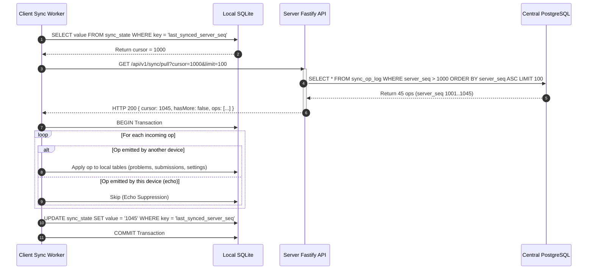
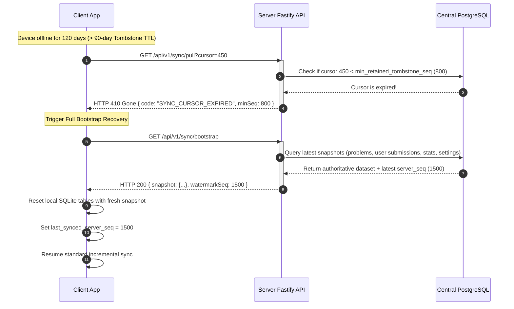

# Offline-First Sync Design Specification

**Document Version:** 1.0.0  
**Author:** Person 2 (Database, Sync & DevOps)  
**Target Audience:** Person 1 (Backend & System Architecture), Person 3 (Client Apps: Web, Desktop, Mobile), Architecture Reviewers  
**Status:** Approved for Implementation  
**Last Updated:** 2026-11-12

---

## 1. Executive Summary & Goals

The DSA Practice Platform supports four distinct client interfaces:

1. **CLI** (Node.js terminal application)
2. **Desktop** (Electron + SQLite)
3. **Mobile** (React Native / Expo + SQLite via native driver)
4. **Web** (React / SPA with in-memory or OPFS/Wasm SQLite fallback)

Users frequently solve algorithmic challenges in disconnected or high-latency environments (airplanes, commutes, campus networks with captive portals). The sync architecture guarantees an **offline-first developer experience**:

- Full local execution and problem evaluation without an internet connection.
- Local persistence in SQLite using WAL mode for instant writes and high concurrency.
- Zero data loss when switching between devices or working offline for extended durations.
- Monotonic, causally consistent synchronization upon reconnecting to the central PostgreSQL server.
- Deterministic conflict resolution requiring zero user intervention for core workflows.

---

## 2. Sync Scope: What Syncs vs. What is Read-Only

```
+---------------------------------------------------------------------------------------+
|                                    CENTRAL POSTGRESQL                                 |
+---------------------------------------------------------------------------------------+
        ^                       ^                       ^                       |
        | [Push/Pull]           | [Push/Pull]           | [Push/Pull]           | [Pull Only]
        | Submissions           | Problem Attempts      | User Stats &          | Problems, Hints,
        | (Append-Only)         | & Code Drafts         | Settings (LWW)        | Test Cases & Solutions
        v                       v                       v                       v
+---------------------------------------------------------------------------------------+
|                                      LOCAL SQLITE                                     |
+---------------------------------------------------------------------------------------+
```

### 2.1 Bi-Directionally Synchronized Entities (Client $\leftrightarrow$ Server)

1. **Submissions (`submissions`)**:
   - Every code run evaluated against test cases generates a submission record.
   - Offline submissions are saved locally in SQLite with `status = 'judged'`, local test execution results, code snapshot, and timestamp.
   - When online, submissions are pushed to the server operation log and ingested into the central PostgreSQL database.
   - Pushes are **append-only** and strictly immutable.

2. **Problem Attempts (`user_problem_stats` / `problem_attempts`)**:
   - Tracks attempt counters, time spent, run frequency, and whether the challenge was solved.
   - Pushed from client to cloud; recomputed authoritatively by the server.

3. **User Stats & Streaks**:
   - Aggregate counts (total solved, topic breakdown, active day streak).
   - Server recomputes stats from the canonical stream of submissions. Client displays optimistic local stats while offline.

4. **User Settings & Preferences (`user_settings`)**:
   - Client editor settings (theme, keybindings, font size, tab width, default language).
   - Synchronized bi-directionally using **Last-Write-Wins (LWW)** governed by Hybrid Logical Clocks (HLC).

### 2.2 Read-Only Downstream Entities (Server $\rightarrow$ Client Only)

1. **Problems (`problems`)**:
   - Slugs, titles, descriptions, difficulty levels, topics, starter code.
   - Seeded and authored centrally. Clients pull new and updated problems down to SQLite. Clients **never** push problem definitions upstream.
2. **Test Cases (`test_cases`)**:
   - Sample cases and validation suites. Pulled read-only by clients to execute code locally in the offline runner.
3. **Hints (`hints`)**:
   - Multi-tier progressive hints. Pulled read-only.
4. **Solutions (`solutions`)**:
   - Reference code and algorithmic complexity explanations. Pulled read-only (locked on client until problem is solved or explicitly unlocked by the user).
5. **Daily Challenges (`daily_challenges`)**:
   - Daily challenge assignments. Pulled read-only.

---

## 3. Operation Log Architecture

Synchronization is modeled on an **append-only Distributed Operation Log (OpLog)**. Rather than syncing table rows directly with brittle diffs, clients record mutation operations as discrete, atomic events.

### 3.1 Operation Log Schema Fields

| Column Name            | PostgreSQL Type                       | SQLite Type          | Description                                                                                                                                                                     |
| :--------------------- | :------------------------------------ | :------------------- | :------------------------------------------------------------------------------------------------------------------------------------------------------------------------------ |
| `server_seq`           | `BIGINT GENERATED ALWAYS AS IDENTITY` | `INTEGER` (Nullable) | Monotonically increasing 64-bit integer assigned **strictly by PostgreSQL** upon ingestion. Used as the linear cursor for incremental pulls. Absent on un-synced local records. |
| `op_id`                | `UUID`                                | `TEXT`               | Globally unique client-generated UUID (UUID v4 or v7). Serves as the primary key for **idempotency deduplication**.                                                             |
| `device_id`            | `TEXT`                                | `TEXT`               | Stable identifier representing the client installation (UUID generated on first launch and stored in secure client storage).                                                    |
| `user_id`              | `UUID`                                | `TEXT`               | ID of the authenticated user who initiated the operation. Prevents multi-tenant data leaks.                                                                                     |
| `entity`               | `TEXT`                                | `TEXT`               | Target domain entity: `submission`, `attempt`, `user_stats`, `settings`, or `tombstone`.                                                                                        |
| `operation_type`       | `TEXT`                                | `TEXT`               | Mutation type: `INSERT`, `UPDATE`, `DELETE`, or `UPSERT`.                                                                                                                       |
| `payload`              | `JSONB`                               | `TEXT`               | Self-contained serialized JSON payload containing the entity snapshot or delta fields.                                                                                          |
| `client_timestamp`     | `TIMESTAMPTZ`                         | `TEXT`               | ISO 8601 UTC timestamp captured by the client machine at mutation time. Used for auditing and display.                                                                          |
| `hybrid_logical_clock` | `TEXT`                                | `TEXT`               | Hybrid Logical Clock string (`l.c.d`) providing strict causal ordering across distributed devices without relying on synchronized wall clocks.                                  |
| `schema_version`       | `INTEGER`                             | `INTEGER`            | Version of the payload structure (defaults to `1`). Used for backward-compatible schema migrations.                                                                             |
| `created_at`           | `TIMESTAMPTZ`                         | `TEXT`               | Server ingestion timestamp in PostgreSQL (`now()`); local creation timestamp in SQLite.                                                                                         |

### 3.2 Hybrid Logical Clock (HLC) Format

To eliminate dependence on brittle physical clocks, all mutation operations capture a **Hybrid Logical Clock (HLC)** as described by Kulkarni et al. (2014).

An HLC string is formatted as:
$$\text{HLC} = \texttt{"<physical\_ms>.<logical\_counter>.<device\_id>"}$$

- `physical_ms`: 64-bit integer representing milliseconds since Unix epoch, formatted as 13 zero-padded digits (e.g., `1731427200000`).
- `logical_counter`: 16-bit integer formatted as 4 hex or decimal digits (e.g., `0000` to `9999`), incremented when multiple events occur within the same physical millisecond or when incoming clocks are equal.
- `device_id`: Shortened client device identifier (e.g., `d1a4f0`) to break ties deterministically.

#### HLC Update Algorithm on Client Mutation:

```typescript
function generateNextHlc(lastHlc: HLC, deviceId: string): HLC {
  const physicalNow = Date.now();
  let l = Math.max(lastHlc.l, physicalNow);
  let c = 0;

  if (l === lastHlc.l) {
    c = lastHlc.c + 1;
  } else {
    c = 0;
  }

  return { l, c, d: deviceId };
}
```

#### HLC Update Algorithm on Receiving Remote Operations:

```typescript
function updateHlcOnReceive(localHlc: HLC, remoteHlc: HLC, deviceId: string): HLC {
  const physicalNow = Date.now();
  const lPrime = Math.max(localHlc.l, remoteHlc.l, physicalNow);
  let cPrime = 0;

  if (lPrime === localHlc.l && lPrime === remoteHlc.l) {
    cPrime = Math.max(localHlc.c, remoteHlc.c) + 1;
  } else if (lPrime === localHlc.l) {
    cPrime = localHlc.c + 1;
  } else if (lPrime === remoteHlc.l) {
    cPrime = remoteHlc.c + 1;
  } else {
    cPrime = 0;
  }

  return { l: lPrime, c: cPrime, d: deviceId };
}
```

---

## 4. Idempotency & Deduplication Engine

Network partitions frequently cause duplicate deliveries. A client might submit a push batch, the server processes and commits the transaction, but the network drops before the HTTP 200 response reaches the client. The client will retry the push upon reconnection.

### 4.1 Server-Side Deduplication Guarantee

1. **Unique Constraint on `op_id`**:
   The PostgreSQL `sync_op_log` table enforces:
   ```sql
   CONSTRAINT sync_op_log_op_id_uq UNIQUE (op_id)
   ```
2. **Deterministic Upsert / Deduplication**:
   When a batch of operations arrives at `POST /api/v1/sync/push`:
   ```sql
   INSERT INTO sync_op_log (
     op_id, device_id, user_id, entity, operation_type,
     payload, client_timestamp, hybrid_logical_clock, schema_version
   ) VALUES ($1, $2, $3, $4, $5, $6, $7, $8, $9)
   ON CONFLICT (op_id) DO NOTHING
   RETURNING server_seq, op_id;
   ```
3. **Idempotent Response Contract**:
   If an incoming operation already exists in `sync_op_log`, the server does **not** fail the batch. It recognizes the operation as previously applied, skips redundant entity re-application, and includes the `op_id` in the acknowledged operations list in the response. The push is completely **side-effect free**.

---

## 5. Sync Protocol: Push in Batches, Pull by Cursor

Synchronization follows a clean decoupled two-phase protocol: **Push local mutations first, then Pull upstream updates.**

```
+---------------+                                   +---------------+
| Client SQLite |                                   | Server PG     |
+---------------+                                   +---------------+
        |                                                   |
        | 1. POST /api/v1/sync/push                         |
        |    Batch: [op1, op2, op3]                         |
        |-------------------------------------------------->|
        |                                                   |--+ Transaction Begin
        |                                                   |  | Ingest into sync_op_log
        |                                                   |  | Apply to domain tables
        |                                                   |  | Assign server_seq
        |                                                   |--+ Commit
        | 2. Push Response:                                 |
        |    Ack: [op1, op2, op3], latest_server_seq = 450  |
        |<--------------------------------------------------|
        |                                                   |
        | 3. GET /api/v1/sync/pull?cursor=420&limit=100     |
        |-------------------------------------------------->|
        |                                                   | Query sync_op_log
        |                                                   | WHERE server_seq > 420
        | 4. Pull Response:                                 |
        |    Ops: [op421..op450], cursor=450, has_more=false|
        |<--------------------------------------------------|
        |                                                   |
        | Apply ops to local SQLite                         |
        | Update local last_synced_server_seq = 450         |
```

### 5.1 Push Protocol (Client $\rightarrow$ Server)

1. Client scans `local_op_log` for entries where `status = 'pending'`.
2. Client chunks pending records into batches of up to **100 operations**.
3. Client issues `POST /api/v1/sync/push` with payload:
   ```json
   {
     "deviceId": "d1a4f028-0000-4000-a000-000000000001",
     "clientVersion": "1.2.0",
     "schemaVersion": 1,
     "operations": [
       {
         "opId": "8f3b2e5a-1111-4222-9333-000000000001",
         "entity": "submission",
         "operationType": "INSERT",
         "payload": {
           "id": "7c1b4e3a-0000-4000-8000-000000000001",
           "problemSlug": "two-sum",
           "code": "function twoSum(nums, target) { ... }",
           "status": "judged",
           "passed": 5,
           "total": 5,
           "results": [...]
         },
         "clientTimestamp": "2026-11-12T16:00:00.000Z",
         "hlc": "1731427200000.0001.d1a4f0"
       }
     ]
   }
   ```
4. Server wraps ingestion in an **ACID transaction**:
   - Validates user JWT.
   - Verifies `operations.length <= 100`.
   - Inserts each operation into `sync_op_log` (with deduplication).
   - Applies the corresponding mutation to PostgreSQL tables (`submissions`, `user_problem_stats`, `user_settings`).
   - Updates `sync_devices` record with `last_seen_hlc` and client metadata.
5. Server returns HTTP 200:
   ```json
   {
     "success": true,
     "acknowledgedOpIds": ["8f3b2e5a-1111-4222-9333-000000000001"],
     "duplicateOpIds": [],
     "serverSeqWatermark": 1054,
     "serverTimestamp": "2026-11-12T16:00:01.200Z"
   }
   ```
6. Client marks acknowledged operations as `status = 'synced'` or prunes them from `local_op_log`.

### 5.2 Pull Protocol (Server $\rightarrow$ Client)

1. Client inspects its local `sync_state` table for `last_synced_server_seq` (defaults to `0` on fresh installation).
2. Client sends `GET /api/v1/sync/pull?cursor=1000&limit=100`.
3. Server executes keyset cursor query:
   ```sql
   SELECT server_seq, op_id, device_id, user_id, entity,
          operation_type, payload, client_timestamp,
          hybrid_logical_clock, schema_version
   FROM sync_op_log
   WHERE server_seq > $1
     AND (user_id = $2 OR entity = 'problems')
   ORDER BY server_seq ASC
   LIMIT $3;
   ```
4. Server returns payload:
   ```json
   {
     "cursor": 1054,
     "hasMore": false,
     "operations": [ ... ]
   }
   ```
5. Client applies each operation to local SQLite inside a single `sqlite3` transaction, ignoring operations originally emitted by its own `device_id` (echo suppression).
6. Client updates `sync_state` setting `last_synced_server_seq = 1054`.

---

## 6. Conflict Resolution Rules per Entity

| Entity                          | Sync Strategy   | Conflict Resolution Rule          | Rationale                                                                                             |
| :------------------------------ | :-------------- | :-------------------------------- | :---------------------------------------------------------------------------------------------------- |
| **Submissions**                 | Bi-directional  | **Append-Only (No Conflicts)**    | Every code execution is an immutable event with a unique UUID. Never updated in place across devices. |
| **Problem Attempts & Stats**    | Bi-directional  | **Authoritative Recomputation**   | `user_problem_stats` is a materialized view derived deterministically from all recorded submissions.  |
| **User Settings / Preferences** | Bi-directional  | **Last-Write-Wins (LWW) via HLC** | Highest HLC wins. Ties broken deterministically by `device_id` lexical order.                         |
| **Problems & Test Cases**       | Downstream only | **Server-Authoritative**          | Read-only to clients. Server publishes new problems; clients pull updates.                            |
| **Deletions / Removals**        | Bi-directional  | **Tombstones with TTL**           | Soft delete markers propagate across offline partitions to prevent resurrection.                      |

### 6.1 Submissions: Append-Only Guarantee

Submissions are modeled as an event stream. When a user runs code on their laptop while offline and later runs code for the same problem on their phone while also offline:

- Laptop generates submission $S_1$ with UUID $U_1$.
- Phone generates submission $S_2$ with UUID $U_2$.
- Upon sync, both $S_1$ and $S_2$ are persisted in PostgreSQL without collision.
- Neither device's work is overwritten.

### 6.2 Stats: Authoritative Recomputation from Submissions

User problem statistics (`attempts`, `solved`, `first_solved_at`, `streak`) are strictly derived:
$$\text{attempts}(u, p) = \text{COUNT}(\text{submissions}(u, p))$$
$$\text{solved}(u, p) = \mathbb{I}(\exists\, s \in \text{submissions}(u, p) \text{ s.t. } s.\text{passed} = s.\text{total})$$
$$\text{first\_solved\_at}(u, p) = \min \{ s.\text{created\_at} \mid s.\text{passed} = s.\text{total} \}$$

If a client reports outdated stats due to offline runs on multiple devices, the server recalculates the authoritative aggregate from the combined set of submissions and streams the updated stats down to all devices during the next pull.

### 6.3 Settings: Last-Write-Wins (LWW) via HLC

When a user updates their editor theme on Device A at $HLC_A$ and on Device B at $HLC_B$:

- If $HLC_A > HLC_B$, Device A's setting wins.
- If $HLC_B > HLC_A$, Device B's setting wins.
- If $HLC_A = HLC_B$, tie-break deterministically: Device with lexically higher `device_id` string wins.
- Since HLC is monotonic and captures causality, LWW over HLC achieves **Strong Eventual Consistency (SEC)**.

### 6.4 Clock Skew, Tombstones, and Schema Versioning

#### A. Clock Skew Mitigation

- Physical clocks on mobile phones and laptops drift by seconds or days (e.g. user manually changes time, dead CMOS battery).
- **Server Guardrail**: If an incoming `client_timestamp` is more than **15 minutes in the future** relative to server `now()`, the server clamps the physical component of the HLC to `now() + 1 ms` while advancing the logical counter $c$. This prevents a rogue device with a clock set to the year 2035 from permanently winning all future LWW conflicts.

#### B. Tombstones (Preventing Resurrection)

- Hard deletions in a distributed system cause the **resurrection anomaly**: If Device A deletes an entity offline by removing the row, Device B (which synced earlier) will push the row back upstream during its next sync.
- **Solution**: Deletions write a tombstone record into `sync_tombstones` and create an operation with `operation_type = 'DELETE'`.
- The row in SQLite and PostgreSQL is marked with `is_deleted = true, deleted_at = now()` (or purged if tracked in `sync_tombstones`).
- **Tombstone TTL**: Tombstones are retained in PostgreSQL for **90 days**. Devices offline for $> 90\text{ days}$ cannot perform incremental cursor pulls and must trigger a snapshot bootstrap.

#### C. Schema Versioning

- Every sync batch and operation contains `schema_version: integer` (current: `1`).
- Backward-compatible additions (new optional fields) increment minor payload definitions without changing `schema_version`.
- Breaking structural schema changes increment `schema_version`. If a legacy client pushes an unsupported schema version, the server responds with HTTP 426 (`Upgrade Required`) along with minimum client version metadata.

---

## 7. Failure Modes & Recovery Strategies

| Failure Mode                         | Trigger Scenario                                                                                                        | System Impact                                                                                | Mitigation & Recovery                                                                                                                                                                                                                                                                                                                                                  |
| :----------------------------------- | :---------------------------------------------------------------------------------------------------------------------- | :------------------------------------------------------------------------------------------- | :--------------------------------------------------------------------------------------------------------------------------------------------------------------------------------------------------------------------------------------------------------------------------------------------------------------------------------------------------------------------- |
| **1. Partial Batch Drop**            | Connection drops mid-push or server worker crashes while processing operation 42 of 100.                                | Incomplete push; client receives no HTTP response.                                           | **Atomic Transaction + Client Retry**: Server wraps entire batch in a PostgreSQL transaction (`BEGIN ... COMMIT`). Either all 100 ops commit or none do. On network timeout, client re-sends the exact same batch. Idempotent `ON CONFLICT (op_id)` guarantees zero duplicate records even if the previous request committed right before connection failure.          |
| **2. Offline for Weeks / Months**    | User leaves tablet in drawer for 4 months; thousands of operations accumulated; server tombstone TTL (90 days) expired. | Client cursor is older than server's retained tombstone window; risk of entity resurrection. | **Bootstrap Fallback (`SYNC_CURSOR_EXPIRED`)**: Server checks client cursor against the tombstone watermark. If expired, server returns HTTP 410 / `SYNC_CURSOR_EXPIRED`. Client purges local cache, downloads fresh full snapshot from `/api/v1/sync/bootstrap`, seeds local SQLite, and resets cursor to latest `server_seq`.                                        |
| **3. Duplicated Device ID**          | User clones disk/VM, restores OS backup to second phone, or tests multi-instance locally with identical `device_id`.    | Two active devices emit identical `device_id` with non-monotonic, conflicting HLC sequences. | **HLC Monotonicity Violation Detection**: Server tracks `last_seen_hlc` per `(user_id, device_id)` in `sync_devices`. If incoming push has $HLC \le \text{last\_seen\_hlc}$ with a divergent `op_id`, server detects device cloning, issues `REGENERATE_DEVICE_ID` directive. Client generates a fresh UUID for `device_id`, re-keys local pending ops, and re-pushes. |
| **4. Giant Local Queue**             | CLI user solves 200 problems offline over weeks of travel.                                                              | Push payload exceeds HTTP body limit (e.g. 10 MB payload).                                   | **Chunked Batching**: Client enforces maximum push batch size of 50 operations. A queue of 200 ops is pushed in 4 sequential HTTP requests with progress reporting.                                                                                                                                                                                                    |
| **5. Database Locked (SQLite Busy)** | Background sync worker attempts to write while user submits code in UI.                                                 | SQLite `SQLITE_BUSY` error.                                                                  | **WAL Mode + Busy Timeout**: All SQLite adapters configure `PRAGMA journal_mode = WAL;` and `PRAGMA busy_timeout = 5000;`. WAL mode allows concurrent readers while one writer is active.                                                                                                                                                                              |

---

## 8. Mermaid Sequence Diagrams

### 8.1 Offline Push Batch Sync Flow

```mermaid
sequenceDiagram
    autonumber
    actor User
    participant UI as Client UI / Engine
    participant SQLite as Local SQLite (WAL)
    participant Worker as Sync Worker
    participant API as Server Fastify API
    participant PG as Central PostgreSQL

    User->>UI: Solve Problem & Run Code (Offline)
    UI->>SQLite: Insert Submission (status: 'judged')
    UI->>SQLite: Insert local_op_log (status: 'pending', op_id, HLC)
    Note over SQLite: Device reconnects to Internet
    Worker->>SQLite: Query pending ops (LIMIT 50)
    SQLite--Worker: Return 50 pending ops
    Worker->>API: POST /api/v1/sync/push (batch of 50 ops)
    activate API
    API->>PG: BEGIN Transaction
    loop For each op in batch
        API->>PG: INSERT INTO sync_op_log ON CONFLICT (op_id) DO NOTHING
        API->>PG: Apply mutation to submissions / stats / settings
    end
    API->>PG: COMMIT Transaction & get assigned server_seq
    API-->>Worker: HTTP 200 { acked: [op_ids], serverSeq: 1045 }
    deactivate API
    Worker->>SQLite: Mark ops as 'synced' in local_op_log
    Worker->>UI: Emit 'sync:completed' event
```

### 8.2 Incremental Pull Sync Flow with `server_seq` Cursor



### 8.3 Long-Offline Re-sync & Bootstrap Recovery



### 8.4 Conflict Resolution & Authoritative Stats Recomputation

```mermaid
sequenceDiagram
    autonumber
    participant DeviceA as Device A (Laptop)
    participant DeviceB as Device B (Mobile)
    participant API as Server API
    participant PG as Central PostgreSQL

    Note over DeviceA,DeviceB: Both devices offline; user attempts 'two-sum' on both
    DeviceA->>DeviceA: Submission SubA (passed: 5/5) recorded locally
    DeviceB->>DeviceB: Submission SubB (passed: 3/5) recorded locally
    Note over DeviceA: Device A goes online first
    DeviceA->>API: POST /api/v1/sync/push [SubA]
    API->>PG: Insert SubA -> Recalculate stats for (user, 'two-sum'): solved = true
    Note over DeviceB: Device B goes online later
    DeviceB->>API: POST /api/v1/sync/push [SubB]
    API->>PG: Insert SubB (Append-only, both SubA & SubB preserved)
    API->>PG: Recalculate stats: attempts = 2, solved = true (SubA remains winning solved state)
    DeviceB->>API: GET /api/v1/sync/pull?cursor=...
    API-->>DeviceB: Receive updated stats & SubA
    DeviceB->>DeviceB: Update local SQLite with authoritative stats
```

---

## 9. Summary for Implementation Teams

1. **Person 1 (Backend & System Architecture)**:
   - Provide endpoints: `POST /api/v1/sync/push`, `GET /api/v1/sync/pull`, `GET /api/v1/sync/bootstrap`, and `POST /api/v1/sync/devices/register`.
   - Implement transactional operation log ingestion and deduplication using PostgreSQL `ON CONFLICT (op_id) DO NOTHING`.
   - Ensure `server_seq` is strictly sequential (`BIGINT GENERATED ALWAYS AS IDENTITY`).
2. **Person 2 (Database & DevOps — Me)**:
   - Implement PostgreSQL migration `002_sync_tables.up.sql` and `002_sync_tables.down.sql`.
   - Implement SQLite sync schema in `core/src/storage/sqlite-schema.ts`.
   - Provide TypeScript contracts and data structures in `core/src/sync`.
3. **Person 3 (Clients & Frontend)**:
   - Implement background sync queue worker in UI clients (Web, Desktop, Mobile).
   - Generate monotonic HLC timestamps using `generateNextHlc()`.
   - Implement echo suppression by ignoring incoming operations matching the local `device_id`.
