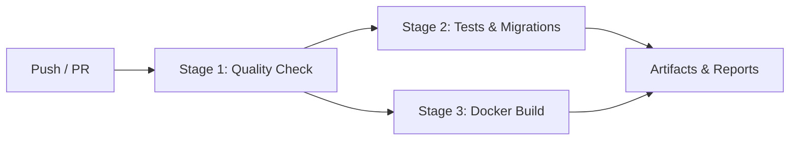

# CI/CD Pipeline Architecture — DSA Practice Platform

## Overview

The Continuous Integration and Continuous Deployment (CI/CD) system is implemented via GitHub Actions (`.github/workflows/ci.yml`). It enforces quality, safety, test coverage, and container buildability on every pull request and push to `main` and feature branches (`person-*/**`).

---

## Pipeline Stages



### 1. Stage 1: Quality & Type Checking (`quality`)

- **Node.js**: `20.x`
- **Steps**:
  - `npm ci` (deterministic dependency installation leveraging npm cache).
  - `npm run lint` (ESLint across all packages).
  - `npm run format` (Prettier code consistency check).
  - Multi-package TypeScript compilation (`npx tsc --noEmit` across `core`, `server`, and `workers`).

### 2. Stage 2: Database Migrations & Test Suites (`test`)

- **Service Containers**:
  - **PostgreSQL 16 Alpine**: Bootstrapped with healthcheck (`pg_isready`).
  - **Redis 7 Alpine**: Bootstrapped with healthcheck (`redis-cli ping`).
- **Steps**:
  - Builds core workspace (`npm run build -w core`).
  - Executes schema migrations (`npm run db:migrate -w server`).
  - Validates seed execution (`npm run db:seed -w server`).
  - Runs full Jest test suite with code coverage (`npm test -- --coverage --runInBand`).

### 3. Stage 3: Container Build Verification (`docker-build`)

- **Buildx Integration**: Utilizes Docker Buildx for cached multi-stage layer builds.
- **Verification Targets**:
  - `infra/docker/Dockerfile.server`
  - `infra/docker/Dockerfile.worker`
- Ensures no devDependencies or transient artifacts leak into production images.

---

## Concurrency Control

```yaml
concurrency:
  group: ${{ github.workflow }}-${{ github.ref }}
  cancel-in-progress: true
```

Prevents redundant pipeline runs on rapid subsequent pushes, optimizing CI runner quota and preventing race conditions during database migration validation.
