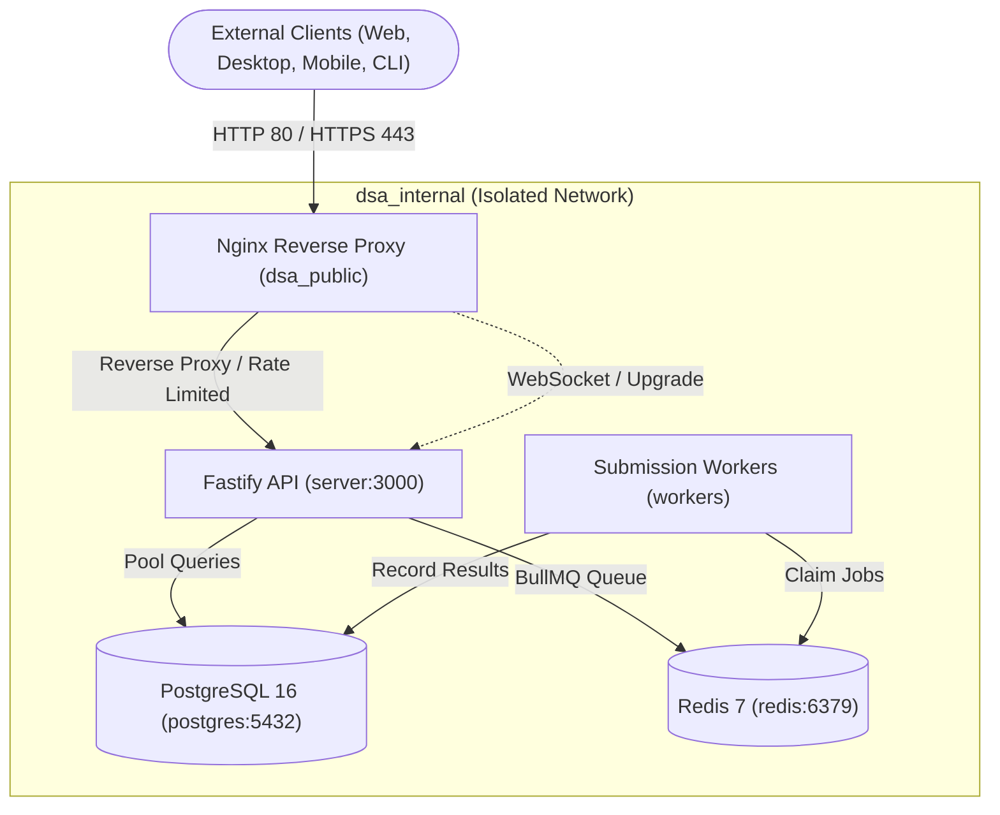

# Production Container Infrastructure — DSA Practice Platform

## Architecture Overview

The production runtime is orchestrated via `infra/docker-compose.prod.yml` and structured around zero-trust network segmentation.



---

## Service Specifications

### 1. Reverse Proxy (`nginx`)

- **Image**: `nginx:1.25-alpine`
- **Port Exposure**: Publicly bound to `:80` and `:443`.
- **Security Headers**: Injects `X-Frame-Options: SAMEORIGIN`, `X-Content-Type-Options: nosniff`, `X-XSS-Protection`, and `Referrer-Policy`.
- **Rate Limiting**: `limit_req_zone` memory zone allocating 10MB, capping client IPs at 30 req/sec with a burst of 50.
- **WebSocket Upgrade**: Dedicated connection handling for Socket.IO (`/socket.io/`) with extended read/write timeouts.

### 2. Fastify API (`server`)

- **Base**: `node:20-alpine` with `dumb-init` as PID 1.
- **Multi-stage Reduction**: Reduces image footprint from ~1.1GB (with build dependencies and source) down to ~140MB production runner.
- **Security**: Runs under unprivileged `node` user (UID 1000).
- **Network**: Bound exclusively to internal network `dsa_internal`.

### 3. Submission Workers (`workers`)

- **Base**: `node:20-alpine` with `dumb-init`.
- **Resource Constraints**: Capped at 2.0 CPUs and 2048MB RAM to protect host stability during heavy code execution loads.

### 4. PostgreSQL 16 & Redis 7

- **Persistence**: Dedicated persistent named volumes (`pg_prod_data`, `redis_prod_data`).
- **Resource Reservations**: Configured CPU and memory floors ensuring deterministic database IOPS.

---

## Operating Instructions

### Launch production stack

```bash
docker compose -f infra/docker-compose.prod.yml up -d --build
```

### Inspect health status

```bash
docker compose -f infra/docker-compose.prod.yml ps
```

### Tail logs

```bash
docker compose -f infra/docker-compose.prod.yml logs -f server nginx
```

### Clean shutdown

```bash
docker compose -f infra/docker-compose.prod.yml down
```
