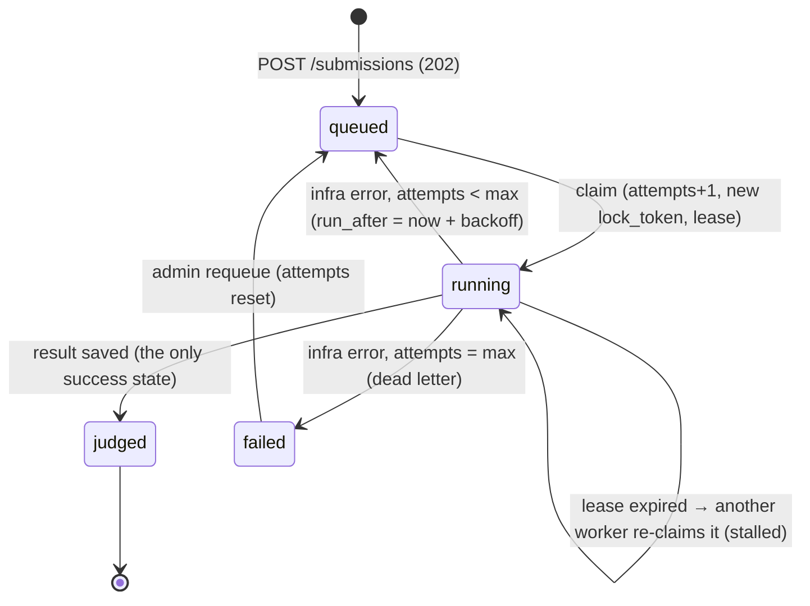

# Submission queue design (Day 6)

The queue is the `submissions` table in PostgreSQL (CR-005): the row **is** the job, so saving a
submission and enqueueing it can never get out of sync. Worker code: `workers/src/pg-queue.ts`.
API side: `server/src/modules/submissions/{routes,queue,admin-routes}.ts`. Schema: migrations 002 + 003.

## Job lifecycle



A wrong answer, a timeout or a crash **inside the sandbox** is a normal `judged` result, never a retry.
Retries are only for infrastructure errors (database down, problem store unreachable, worker bug).

| Column (migration 003) | Purpose                                                                                                |
| ---------------------- | ------------------------------------------------------------------------------------------------------ |
| `attempts`             | Claims so far. Incremented when claimed, so a worker that dies mid-job still uses up an attempt.       |
| `run_after`            | Backoff. A queued row is not claimable before this time.                                               |
| `lock_token`           | New UUID on every claim. Only the current holder can renew the lease, fail the job or save the result. |
| `locked_until`         | Lease. The worker renews it every `lease/3`. A `running` row past its lease is stalled.                |
| `last_error`           | Why the last attempt failed (shown in the dead-letter list).                                           |

## Settings

| Env                   | Default | Meaning                                                                     |
| --------------------- | ------- | --------------------------------------------------------------------------- |
| `WORKER_MAX_ATTEMPTS` | 3       | Total tries, crashed runs included, before the dead-letter list             |
| `WORKER_BACKOFF_MS`   | 1000    | Retry _n_ waits `backoff · 2^(n-1)`: 1 s, 2 s, 4 s…                         |
| `WORKER_LEASE_MS`     | 30000   | How long a dead worker's job stays stuck before another worker re-claims it |
| `WORKER_METRICS_PORT` | off     | Serves `GET /metrics` (Prometheus) on this port                             |
| `QUEUE_MAX_WAITING`   | 500     | API returns 429 when this many submissions are waiting                      |
| `QUEUE_RETRY_AFTER_S` | 10      | `Retry-After` header on that 429                                            |

## Failure scenarios

| Scenario                                                                  | What happens                                                                                                                                   | Result for the user                                              |
| ------------------------------------------------------------------------- | ---------------------------------------------------------------------------------------------------------------------------------------------- | ---------------------------------------------------------------- |
| Worker gets SIGTERM (deploy, scale-down)                                  | Stops claiming new work, finishes the jobs it has, exits 0                                                                                     | Normal result                                                    |
| Worker is SIGKILLed / OOM / machine dies mid-job                          | Its lease is no longer renewed. After `WORKER_LEASE_MS` another worker re-claims the row (attempt 2)                                           | Result arrives up to one lease later. Judged once (chaos script) |
| Worker is frozen (GC pause, network partition) past its lease, then wakes | Another worker re-claimed the row with a new `lock_token`. The zombie's final ownership check fails (`LeaseLostError`), so it drops its result | Judged once                                                      |
| Database error while judging                                              | `failJob`: back to `queued` with exponential backoff                                                                                           | Small delay                                                      |
| Same error on every attempt                                               | After `WORKER_MAX_ATTEMPTS`, status `failed`, `last_error` set (dead letter)                                                                   | Sees `failed`. An admin can requeue it                           |
| Job kills its worker every time (poison pill)                             | Each crash uses up an attempt. Claim number `max+1` dead-letters it without running it                                                         | `failed`, never an endless crash loop                            |
| Stats hook fails after the result was saved                               | `failJob` only touches rows still `running` with our token, so the saved result stays                                                          | Normal result                                                    |
| `LISTEN` connection drops / a NOTIFY is lost                              | Workers still poll every `WORKER_POLL_MS`                                                                                                      | Up to one poll interval of delay                                 |
| API worker pool far behind                                                | `POST /submissions` returns 429 + `Retry-After` once `QUEUE_MAX_WAITING` rows are waiting. Idempotent replays are still answered               | Retries later instead of piling up work                          |
| Database down                                                             | API: 500. Workers back off by one poll interval per failed claim. Nothing is lost: jobs are rows                                               | Resumes when the database is back                                |

## How duplicates are avoided ("exactly once" from the user's point of view)

Delivery is _at least once_ (a re-claimed job runs again). The **effect** happens once:

1. **Duplicate requests:** the `Idempotency-Key` header plus a unique index on `(user_id, idempotency_key)` give one row per key, even when retries race. A different body with the same key gets 409.
2. **Duplicate claims:** `FOR UPDATE SKIP LOCKED` hands a row to one worker at a time.
3. **Duplicate saves:** right before saving, the worker renews its lease with its `lock_token` (`extendLease` doubles as "may I save?"). Only one token is valid at a time, so only one worker can save. Saving also updates `user_problem_stats`, so stats count once too.
4. **Duplicate deliveries of a finished job:** `judgeSubmission` returns early for rows that are already `judged` or `failed`.

The remaining window: a worker passes the ownership check, then stalls longer than a whole lease
before its save commits. With a 30 s lease and a save that takes milliseconds, we accept that risk.
Closing it would need the save and the token check in one transaction, which means changing Person 2's repository.

## Scaling workers horizontally

- Start more worker processes, on the same machine or others, all pointing at the same `DATABASE_URL`. No coordinator, no config change: SKIP LOCKED spreads the rows.
- Per process: `WORKER_CONCURRENCY` judging loops, **default = CPU cores** (Day 9; was 2). Each loop runs one sandbox child at a time, so this keeps every core busy without oversubscribing. The load test measured ~2× throughput from this alone (`load-test-report.md`).
- Connections: each process uses at most `WORKER_CONCURRENCY + 2` and never more than its pool (`DB_POOL_MAX`, default 10): loops borrow a connection per query and hold none while the sandbox runs (budget: one per loop, one held for `LISTEN`, one for heartbeats/metrics). PostgreSQL `max_connections` is the real ceiling. Past ~100 workers, put PgBouncer in front (session mode for the `LISTEN` connection).
- Claim cost stays flat as history grows: partial indexes cover only `queued` rows (002) and `running` rows (003).
- Ceiling: one PostgreSQL primary handles thousands of claims per second, far beyond what the sandbox's CPU cost allows per worker. If that ever becomes the bottleneck, move to Redis/BullMQ (CR-005 trade-off).

## Metrics (for Person 2's Prometheus)

Scrape `http://<worker>:$WORKER_METRICS_PORT/metrics`:

| Metric                           | Type      | Notes                                                                           |
| -------------------------------- | --------- | ------------------------------------------------------------------------------- |
| `dsa_queue_waiting`              | gauge     | `status = queued` (includes retries in backoff). Read from PostgreSQL on scrape |
| `dsa_queue_active`               | gauge     | `status = running`                                                              |
| `dsa_queue_failed`               | gauge     | Dead-letter list size                                                           |
| `dsa_queue_jobs_total{outcome}`  | counter   | `judged`, `retried`, `dead`, `lease_lost`; per worker process                   |
| `dsa_queue_job_duration_seconds` | histogram | Claim → saved result; buckets 0.1 … 30 s                                        |

The gauges are queue-wide, so every worker reports the same value: use `max(dsa_queue_waiting)`, not `sum`.
Counters and the histogram are per process: `sum(rate(dsa_queue_jobs_total[5m])) by (outcome)`,
`histogram_quantile(0.95, sum(rate(dsa_queue_job_duration_seconds_bucket[5m])) by (le))`.

## Chaos test

`workers/scripts/chaos.ts` starts worker A, submits a slow (correct) solution, SIGKILLs A as soon as
it claims the job, starts worker B, and checks five things:

- the user sees one correct result
- B produced it
- `attempts = 2`
- `user_problem_stats` counted the attempt once
- B's `/metrics` reports 1 judged job, 1 duration sample and 0 active

```bash
npm run build
DATABASE_URL=postgresql://postgres@localhost:5432/dsa_portal_test npm run chaos -w workers
```

It also runs as part of `TEST_DATABASE_URL=… npx jest workers`.
