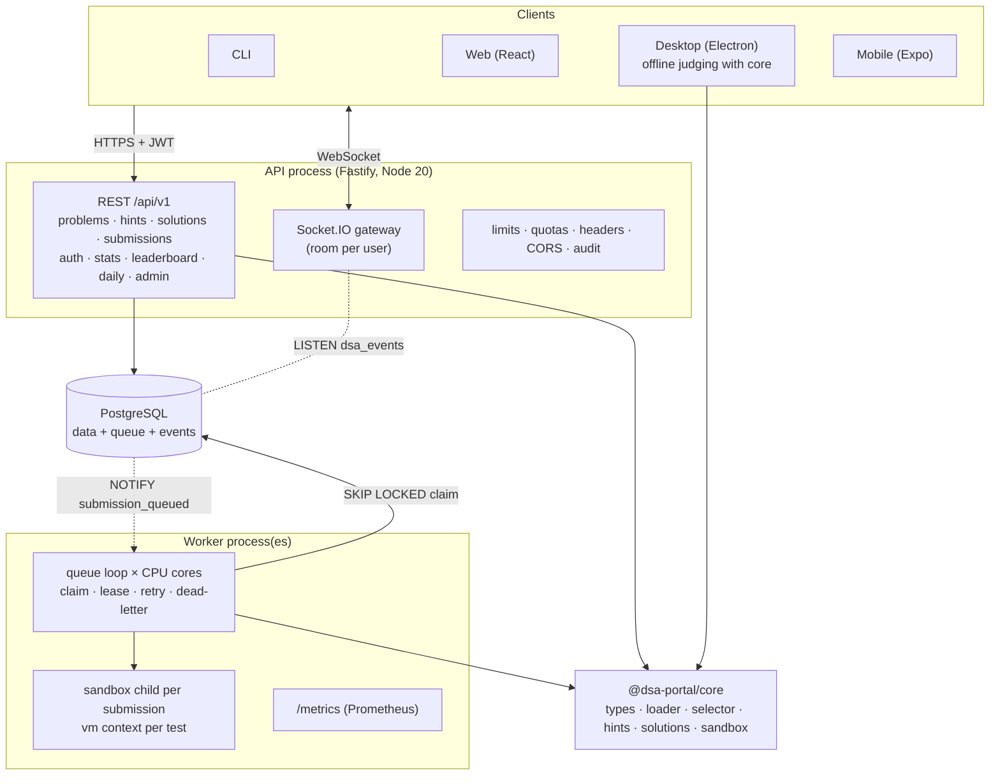
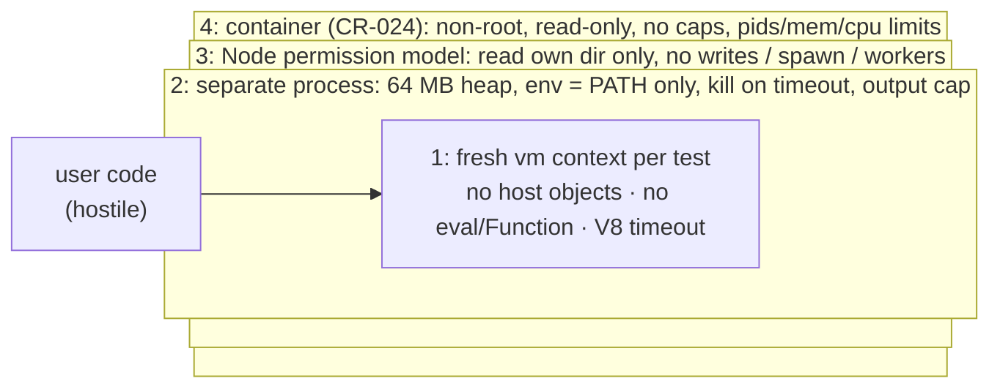
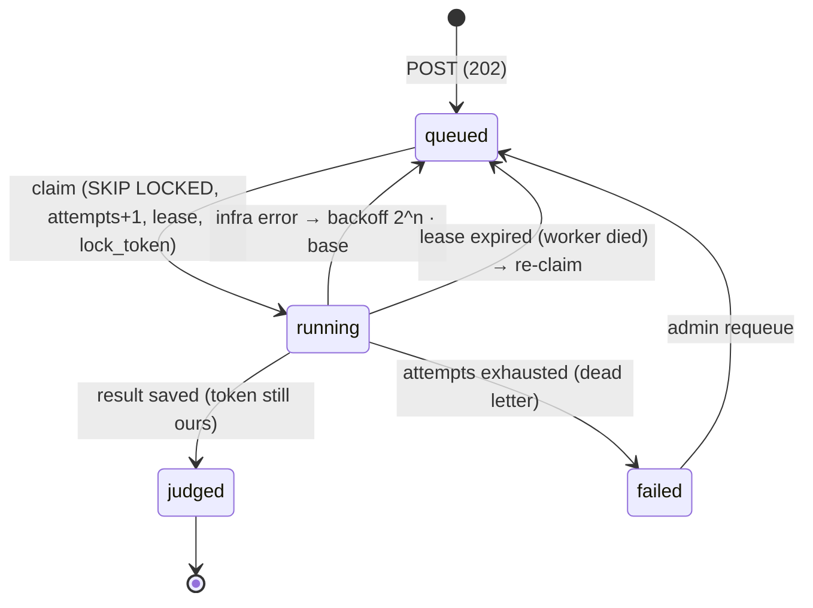

# DSA Practice Platform: Report, Part 1 (Backend, Core Engine and System Design)

**Author:** Person 1. **Scope:** the problem engine (`/core`), the code-execution sandbox, the REST API (`/server`),
the job queue and workers (`/workers`), real-time events, leaderboard, daily challenge, security hardening and
load testing. Database, sync and DevOps are covered in Part 2 (Person 2); clients, auth, stats and caching in Part 3 (Person 3).

---

## 1. Architecture

The platform started as a single-user Node.js CLI. It is now **one engine behind four front ends** (CLI, web,
desktop, mobile). The backend is a **modular monolith plus one separate worker process**, with PostgreSQL as the
only stateful service.



**Why a monolith plus a worker** (details in [`architecture.md`](../architecture.md) §4):

- One repo, one install, one test run, and types shared through npm workspaces. A 3-person, 10-day project can't afford service discovery, distributed tracing and per-service CI.
- Judging is the one thing with a different resource profile: CPU-heavy, untrusted, slow. Putting it in its own process keeps API latency flat and lets it scale on its own.
- `@dsa-portal/core` has no HTTP or database dependency, so the CLI, the server, the worker and the desktop app (offline mode) all run the same engine.

**Contract first:** `docs/openapi.yaml` is the source of truth. A contract test sends a real request to every registered
route and validates each response against the spec with Ajv, so code and spec can't drift. The spec is served
as Redoc at `/docs`. One error format everywhere: `{ error, message, statusCode, timestamp, path }`. One pagination
format: an opaque keyset cursor.

### End-to-end flow

```mermaid
sequenceDiagram
    participant C as Client
    participant API as API
    participant PG as PostgreSQL
    participant W as Worker
    participant S as Sandbox child
    C->>API: POST /submissions {problemId, code} (+ Idempotency-Key)
    API->>PG: replay? quota? queue depth? problem exists?
    API->>PG: INSERT submission (queued) + audit row
    API-->>C: 202 {submissionId}
    PG-->>W: NOTIFY (trigger)
    PG-->>API: NOTIFY dsa_events → submission:queued
    W->>PG: claim FOR UPDATE SKIP LOCKED (lease + lock_token)
    PG-->>API: submission:running
    W->>S: all test cases, one child
    S-->>W: one JSON line per test
    W->>PG: save result + stats (one transaction, token checked)
    PG-->>API: submission:finished, leaderboard:updated
    API-->>C: Socket.IO events (room user:<id>)
    C->>API: GET /submissions/{id} (per-test results; also the polling fallback)
```

## 2. Execution engine and sandbox security

**The engine** (`/core`): zod-validated problem loader, a random selector by topic and difficulty that avoids the last N
problems seen, progressive hints (level 1…n), solutions that unlock after a full pass, and storage interfaces
that Person 2 implements for PostgreSQL and SQLite. Core coverage: 96.7% statements, 84% branches.

**The sandbox** runs untrusted JavaScript. The options compared in [`sandbox-decision.md`](../sandbox-decision.md) were
`child_process`, `worker_threads`, `vm` and `isolated-vm`. We chose **a child process with a `vm` context inside**, because it
gives an OS-level kill switch and memory cap, needs no native addon, and runs unchanged in Electron.



| Hostile sample (all in `core/__tests__/sandbox.test.ts`)    | Stopped by                                                                                    |
| ----------------------------------------------------------- | --------------------------------------------------------------------------------------------- |
| `while(true){}`                                             | V8 per-test timeout (wall 1), process kill (wall 2)                                           |
| memory bomb                                                 | `--max-old-space-size` (wall 2)                                                               |
| `require('fs')`, `process.exit`, network                    | nothing reachable in the context (wall 1); fs and spawn also blocked by wall 3                |
| `this.constructor.constructor('return process')()`          | context has no host objects, string code generation is off (wall 1)                           |
| prototype pollution, faking the verdict via `JSON`/`toJSON` | built-ins captured before user code runs, null-prototype report, verdict compared on the host |
| huge console output                                         | output cap per test + `maxBuffer`                                                             |
| replacing the runner                                        | runner sits under a random, non-writable, non-configurable name                               |
| endless promise chain                                       | `microtaskMode: 'afterEvaluate'` puts microtasks under the timeout                            |

Result shape: `{ status: passed|failed|error|timeout, perTest: [{ id, passed, expected, actual, runtimeMs, error }] }`.
A full threat model (STRIDE, residual risks) is in [`threat-model.md`](../threat-model.md).

## 3. Queue design

Redis + BullMQ was the brief. We used **the `submissions` table as the queue** (CR-005), because the job and its
result then live in the same transactional store, and the team runs one service fewer.



- **Exactly once for the user:** `SKIP LOCKED` gives a row to one worker. The `lock_token` fences out a "zombie" worker that lost its lease. An `Idempotency-Key` unique index stops duplicate POSTs, even racing ones. The chaos script SIGKILLs a worker mid-job and checks for exactly one result.
- **Only infrastructure errors are retried:** wrong answers and timeouts are correct verdicts.
- **Poison pills:** attempts are counted at claim time, so a job that crashes its worker ends in the dead-letter list, not a crash loop.
- **Backpressure:** `429 QUEUE_FULL` + `Retry-After` once `QUEUE_MAX_WAITING` jobs are waiting.
- **Metrics:** `dsa_queue_waiting/active/failed`, `dsa_queue_jobs_total{outcome}` and a duration histogram, read from PostgreSQL at scrape time.

Full failure table: [`queue-design.md`](../queue-design.md).

## 4. Real-time design

Socket.IO on the API's HTTP server. The JWT is checked in the handshake, and each socket joins `user:<id>`. Events:
`submission:queued|running|finished` (to the submitter only), `leaderboard:updated` and `daily:new` (to everyone).

**Database triggers are the event source** (migration 005). Every status change, from any code path (API, worker,
retry, admin requeue), calls `pg_notify`. Each API instance `LISTEN`s and forwards to its own sockets. This is the
same fan-out the Socket.IO Redis adapter gives, without Redis. Events fire only on commit, so a client never hears about
a result it can't read yet. Payloads are small ids ("what changed"), and REST says what it is now. Polling stays as
the fallback because NOTIFY isn't replayed.

**Leaderboard:** ranked by problems solved, then by who reached that count first, with keyset pagination and `period=week|all`.
**Daily challenge:** a deterministic pick per UTC day (sha256 of the date over the sorted slugs). The worker inserts it
just after midnight; `ON CONFLICT DO NOTHING` plus the insert trigger means `daily:new` fires exactly once, with no locks
or leader election.

## 5. Security hardening (Day 8)

- **Rate limits:** 300 requests/min per IP and 120/min per user (in memory, per instance).
- **Quotas:** 10 submissions/min and 500/day per user, **counted in PostgreSQL** with an exact `Retry-After` taken from the n-th newest submission in the window.
- **Request hygiene:** helmet-style headers, a CORS allow-list shared with Socket.IO, a 512 KiB body limit, zod on every input, `trustProxy` only when configured.
- **Audit:** one `audit_log` row per submission (user, problem, code hash, IP).
- **Dependencies:** Fastify 4 (end-of-life, auth-bypass advisory) → 5. `npm audit` is clean on the server side except zod 3, which the body limit mitigates.

## 6. Scalability

**Load test** ([`load-test-report.md`](../load-test-report.md)): 100 concurrent submissions from 100 users against the real built
processes. The profile showed judging was the bottleneck (Node startup was ~95% of judging CPU, and 2 of 10 cores were in use), not
the API or the queue.

|                                                      | end-to-end p50 | p95       | throughput  | errors |
| ---------------------------------------------------- | -------------- | --------- | ----------- | ------ |
| Before                                               | 6.1 s          | 12.7 s    | 7.5 /s      | 0%     |
| After (one child per submission + one loop per core) | **1.0 s**      | **1.7 s** | **47.8 /s** | 0%     |

A third change (parallel reads on the accept path) **measured flat and was reverted**.

**Scaling out:**

- **Workers:** add processes or machines. `SKIP LOCKED` makes this linear until PostgreSQL connections run out (each worker uses ≤ concurrency+2); then PgBouncer.
- **API:** stateless apart from the per-instance rate-limit counters. Run N instances behind a load balancer. Real-time works across instances because every instance LISTENs.
- **Database:** the limit at the far end. Read replicas for leaderboard/stats, and partition `submissions` by month if it grows into the hundreds of millions.

## 7. Trade-offs

| Decision                                                     | Gain                                                                             | Cost / when to revisit                                                                                                                                |
| ------------------------------------------------------------ | -------------------------------------------------------------------------------- | ----------------------------------------------------------------------------------------------------------------------------------------------------- |
| PostgreSQL as queue and event bus (not Redis/BullMQ)         | one service fewer; job and result are transactional; triggers can't be forgotten | we built retries/leases/metrics ourselves. Revisit at ~thousands of jobs/s or if Redis arrives anyway (swap behind `SubmissionQueue` / `EventSource`) |
| child process + vm (not isolated-vm / containers)            | OS kill switch, no native addon, works in Electron                               | ~40 ms Node start per submission; kernel shared with the worker. Containers or gVisor for stronger isolation                                          |
| one child per submission (Day 9)                             | 3.7× judging throughput                                                          | a memory bomb ends the rest of that submission's tests (same verdict)                                                                                 |
| quotas in PostgreSQL, rate limits in memory                  | quotas exact across instances; limits cost nothing                               | N instances allow N× the request rate. Move counters to Redis when scaling out                                                                        |
| small event payloads + REST refetch                          | missed or reordered events can't show wrong data for long                        | one extra GET per finished submission                                                                                                                 |
| modular monolith                                             | speed, shared types, one deploy                                                  | coarse scaling; split services only where profiles differ (as we did for the worker)                                                                  |
| hand-written Prometheus text, security headers, rate limiter | no dependencies for ~100 lines total                                             | we maintain them; they are small and tested                                                                                                           |

## 8. Future work

1. **Container per job** (`--network none`, read-only, seccomp, pids limit) or **gVisor/Firecracker**, for a kernel boundary and no network even after a vm escape.
2. **A warm pool** of pre-started sandbox children to remove the remaining Node start per submission.
3. **Redis** for rate-limit counters and Person 3's cache, if the API runs several instances; reconnect logic for the LISTEN connection.
4. Re-check socket tokens periodically and disconnect expired ones.
5. **More languages:** a per-language runner behind the same `submitCodeSandbox` interface (e.g. Python in a container).
6. zod 4, Expo SDK and React Router upgrades to clear the remaining client-side `npm audit` findings (CR-025).
