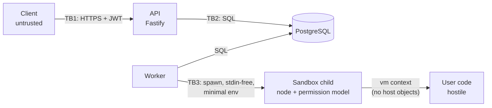

# Threat model: running untrusted code (Day 8, Person 1)

STRIDE review of the path a submission takes: client → API → PostgreSQL queue → worker → sandbox child → result → client.
Every "mitigation in place" names the code that does it, so the model can be checked against the repo.

## Assets and trust boundaries

| Asset                                         | Where                               |
| --------------------------------------------- | ----------------------------------- |
| Server secrets (`JWT_SECRET`, `DATABASE_URL`) | API and worker process env          |
| Other users' code, results, stats, accounts   | PostgreSQL                          |
| Hidden test cases and solutions               | PostgreSQL / `core/problems`        |
| Worker host CPU, memory, disk, network        | worker machine / container          |
| Honest leaderboard                            | `user_problem_stats`, `submissions` |

TB3 is the boundary that matters most: everything right of it is attacker-controlled.

## STRIDE

### S: Spoofing

| Threat                                 | Mitigation in place                                                                        | Code                        |
| -------------------------------------- | ------------------------------------------------------------------------------------------ | --------------------------- |
| Forged or stolen access token          | HS256 JWT, 15-min access tokens, refresh rotation with reuse detection (Person 3)          | `server/src/modules/auth/*` |
| Token for a deleted user               | Admin routes re-read the role through `AuthStore.findById`                                 | `admin-routes.ts`           |
| Socket.IO impersonation                | JWT checked in the handshake; each socket only joins `user:<own id>`                       | `realtime/gateway.ts`       |
| Spoofed client IP in audit/rate limits | `X-Forwarded-For` is ignored unless `TRUST_PROXY=true` (set it only behind your own proxy) | `app.ts`                    |

### T: Tampering

| Threat                                                                        | Mitigation in place                                                                                  | Code                                     |
| ----------------------------------------------------------------------------- | ---------------------------------------------------------------------------------------------------- | ---------------------------------------- |
| User code fakes its own verdict (overrides `JSON`, `Object.prototype.toJSON`) | Built-ins captured before user code runs; null-prototype report object; verdict compared on the host | `core/src/sandbox-exec.js`, `sandbox.ts` |
| Code injection into the wrapper                                               | User code is a separate file, never pasted into wrapper source                                       | `prepareTestFiles`                       |
| Prototype pollution reaching the host                                         | vm context created from `Object.create(null)`; only JSON strings cross back                          | `sandbox-exec.js`                        |
| SQL injection                                                                 | Parameterised queries everywhere; zod validates every body/query/param                               | `server/src/**`                          |
| Zombie worker overwrites a newer result                                       | Lease + fencing `lock_token` (Day 6)                                                                 | `workers/src/pg-queue.ts`                |

### R: Repudiation

| Threat                   | Mitigation in place                                                                         | Code                                                |
| ------------------------ | ------------------------------------------------------------------------------------------- | --------------------------------------------------- |
| "I never submitted that" | `audit_log` row per submission: user, submission id, problem, SHA-256 of the code, IP, time | `submissions/routes.ts` → `PostgresAuditRepository` |
| Untraceable requests     | Request id on every pino log line and in the `x-request-id` response header                 | `app.ts`                                            |

### I: Information disclosure

| Threat                                                               | Mitigation in place                                                                                                             | Code                                         |
| -------------------------------------------------------------------- | ------------------------------------------------------------------------------------------------------------------------------- | -------------------------------------------- |
| User code reads secrets from env                                     | Child gets only `PATH` + `NODE_OPTIONS`; `process` is not reachable from the vm context anyway                                  | `childCommand`                               |
| User code reads files (`/etc/passwd`, other submissions, test cases) | No `require` in the context **and** Node permission model: fs reads limited to the wrapper and this test's temp dir             | `childCommand` (`--experimental-permission`) |
| Reading another user's submission                                    | `GET /submissions/:id` 404s for non-owners (no id probing)                                                                      | `submissions/routes.ts`                      |
| Stack traces / file paths in errors                                  | Central error handler returns the agreed `Error` body; 5xx messages are generic; sandbox errors are rewritten to plain messages | `app.ts`, `toPerTestResult`                  |
| Clickjacking / MIME sniffing / referrer leaks                        | helmet-style headers on every response (`nosniff`, `DENY`, `no-referrer`, HSTS, CSP `default-src 'none'`)                       | `SECURITY_HEADERS` in `app.ts`               |
| Cross-site reads from a hostile origin                               | CORS and Socket.IO allow-list (`CORS_ORIGINS`); no origin allowed in production when unset                                      | `app.ts`                                     |

### D: Denial of service

| Threat                                    | Mitigation in place                                                                                    | Code                                |
| ----------------------------------------- | ------------------------------------------------------------------------------------------------------ | ----------------------------------- |
| Infinite loop                             | Per-test timeout (2 s) kills the child; total timeout 30 s                                             | `sandbox.ts`                        |
| Memory bomb                               | `--max-old-space-size=64` per child                                                                    | `childCommand`                      |
| Output flood                              | Output cap inside the context + `maxBuffer` on the pipe; child stderr dropped                          | `sandbox-exec.js`, `sandbox.ts`     |
| Fork bomb / spawning processes or threads | Permission model forbids `child_process` and `worker_threads` in the child                             | `childCommand`                      |
| Request flood from one IP                 | 300 req/min per IP → `429 RATE_LIMITED` + `Retry-After`                                                | `lib/rate-limit.ts`, `app.ts`       |
| One account from many IPs                 | 120 req/min per user                                                                                   | same                                |
| Submission spam                           | 10/min and 500/day per user, counted in PostgreSQL (holds across API instances) → `429 QUOTA_EXCEEDED` | `submissions/routes.ts`, `queue.ts` |
| Queue backlog                             | `429 QUEUE_FULL` once `QUEUE_MAX_WAITING` are waiting                                                  | Day 6                               |
| Huge bodies / parser memory               | `bodyLimit` 512 KiB → `413`; code ≤ 100 000 chars                                                      | `app.ts`, zod                       |
| Poison-pill job crash-loops workers       | Attempts counted at claim; dead-letter after `WORKER_MAX_ATTEMPTS`                                     | Day 6                               |
| Login brute force                         | Login throttle per IP and per account (Person 3)                                                       | `auth/throttle.ts`                  |

### E: Elevation of privilege

| Threat                                                         | Mitigation in place                                                                                                                                                         | Code                                 |
| -------------------------------------------------------------- | --------------------------------------------------------------------------------------------------------------------------------------------------------------------------- | ------------------------------------ |
| vm escape (`this.constructor.constructor('return process')()`) | Context has no host objects, so constructors are the context's own; `codeGeneration.strings=false` blocks `Function`/`eval`; tested                                         | `sandbox-exec.js`, `sandbox.test.ts` |
| vm escape via a V8/Node bug                                    | Second wall: the child is a separate OS process under the permission model (no fs writes, no reads outside its dir, no processes, no workers), with no secrets in env       | `childCommand`                       |
| Normal user reaches admin routes                               | Role check on every admin route (`authorize('admin')`)                                                                                                                      | auth/admin modules                   |
| Worker compromise → host                                       | **Partly open:** the worker should run as non-root, read-only FS, no capabilities, CPU/memory/pids limits. Docker files belong to Person 2: see CR-024 for the exact config | CR-024                               |

## Residual risks (accepted for this project)

1. **Network from the sandbox child.** Node 20's permission model does not cover sockets. User code can't reach `require('net')` from the vm context, so it needs a vm escape first. Fix: run judging in a container with `network_mode: none` (future work).
2. **Shared kernel.** A kernel or V8 exploit inside the child runs as the worker's OS user. CR-024 (non-root, no caps) limits the damage. Container-per-job or gVisor removes it.
3. **Per-IP/per-user rate limits are per API instance** (memory). With N instances the real limit is N×. Quotas are global (PostgreSQL). Move the counters to Redis when we scale out (`shortcut:` comment in `lib/rate-limit.ts`).
4. **Quota race.** Two requests at the same millisecond can both pass the count, so a user can get 1–2 extra submissions per window. Harmless next to the queue's backpressure.
5. **Open sockets outlive their token** (checked at connect only, Day 7). With 15-min tokens the window is small.
6. **Desktop (Electron 28 = Node 18) has no permission model.** Offline judging there runs the user's own code on their own machine, so the attacker and victim are the same person.
7. **Timing side channels** (`runtimeMs`) could leak a little about hidden inputs. Test cases are not secret enough to matter.
8. **npm audit:** see below. The remaining findings are in client toolchains, or are mitigated.

## npm audit (Day 8)

`npm audit --omit=dev` before: 56 findings (3 critical, 23 high, 26 moderate, 4 low). After: 50 (1 critical, 21 high, 25 moderate, 3 low). **No finding is left in the server or worker dependency tree except zod (mitigated).** The one remaining critical is `tar` in the Expo CLI.

| Package                                                                                                                     | Severity      | Where                              | Action                                                                                                                                                                          |
| --------------------------------------------------------------------------------------------------------------------------- | ------------- | ---------------------------------- | ------------------------------------------------------------------------------------------------------------------------------------------------------------------------------- |
| `fastify` 4.29 (auth bypass via malformed URLs to not-found handlers, validation bypasses, HTTP/2 DoS)                      | high          | server                             | **Fixed:** upgraded to Fastify 5.12.8 (v4 is end-of-life)                                                                                                                       |
| `fast-jwt` 4.0 via `@fastify/jwt` 8 (alg confusion, cache confusion, empty-secret bypass)                                   | critical      | server                             | **Fixed:** `@fastify/jwt` 10.2.7 → `fast-jwt` 6.3.6. We use HS256 with a static secret, so most were not reachable, but the fix is cheap                                        |
| `find-my-way` 8 (HTTP/2 DoS)                                                                                                | high          | server                             | **Fixed** with Fastify 5 (find-my-way 9.10)                                                                                                                                     |
| `@fastify/cors` 9                                                                                                           | n/a           | server                             | Upgraded to 11.4.3 (Fastify 5 peer)                                                                                                                                             |
| `dompurify` (via `monaco-editor` 0.57)                                                                                      | critical      | web                                | **Fixed** by dedupe: web uses `monaco-editor` 0.52, which does not pull it                                                                                                      |
| `zod` 3 (memory exhaustion on oversized constrained collections)                                                            | high          | core, server, mobile toolchain     | **Mitigated:** bodies are capped at 512 KiB before zod runs, and no schema validates large arrays from users. zod 4 is a breaking change across core/server/mobile; future work |
| `tar`, `@xmldom/xmldom`, `postcss`, `glob`, `minimatch`, `uuid`, `send`, `cacache`, `@expo/*`, `expo*`, `babel-preset-expo` | critical–low  | mobile (Expo 51 CLI/build tooling) | **Documented:** build-time tools on the developer machine, not shipped to users or the server. Fix needs Expo SDK 58 (major). Person 3 owns `/mobile`: CR-025                   |
| `react-native`, `@react-native-community/cli*`, `fast-xml-parser`, `deepmerge`                                              | moderate–low  | mobile                             | Same: CR-025                                                                                                                                                                    |
| `react-router`, `react-router-dom`, `@remix-run/*`, `turbo-stream`                                                          | high–moderate | web                                | Open redirect / DoS in React Router 6 SSR paths. The web app is a client-only SPA (no SSR, no `@remix-run` server). Fix is React Router 7 (major): CR-025                       |
| `@react-navigation/*`, `expo-router`, `query-string`, `decode-uri-component`                                                | high          | mobile                             | Client-side URL parsing DoS. Expo Router major: CR-025                                                                                                                          |
| `image-size`, `monaco-editor` (low)                                                                                         | high/low      | toolchain/web                      | Build-time / client only: CR-025                                                                                                                                                |

## Future work

- **Container-per-job** (one short-lived container per submission, `--network none`, read-only, seccomp default, `--pids-limit`) or **gVisor/Firecracker** for a kernel boundary.
- Move rate-limit counters to Redis (shared across instances).
- Re-check socket tokens on an interval and disconnect expired ones.
- zod 4, Expo SDK upgrade, React Router 7.
