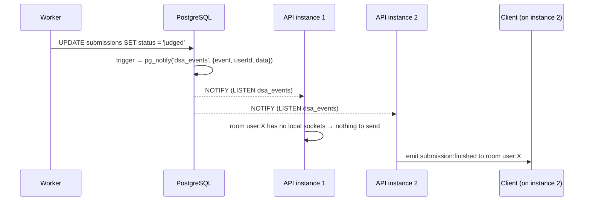

# Real-time events (Socket.IO)

Day 7. Replaces the Day 1 draft (`auth:join`, `submission:result`, `leaderboard:update`) with the event names from the Day 7 brief. Clients written against the draft must switch to the names below.
Code: `server/src/modules/realtime/gateway.ts`. Triggers: migration `005_realtime_events`.

## Connecting

Same host and port as the REST API, default Socket.IO path `/socket.io`, namespace `/`.
Authenticate in the handshake with the **access token** (the same JWT you send as `Authorization: Bearer`):

```ts
import { io } from 'socket.io-client';
const socket = io('http://localhost:3000', { auth: { token: accessToken } });
socket.on('connect_error', (err) => {
  if (err.message === 'UNAUTHORIZED') {
    // token missing/invalid/expired: refresh it, set socket.auth = { token: newToken }, then socket.connect()
  }
});
```

- A bad or expired token rejects the connection with `connect_error` and message `UNAUTHORIZED`.
- Each socket joins the room `user:<userId>`. Submission events go only to that room, and leaderboard/daily events go to everyone.
- The token is checked only at connect time. An open socket stays open after its token expires; reconnects need a fresh one.
- Clients don't emit anything. All events are server → client.

## Events

All payloads are small on purpose (PostgreSQL NOTIFY caps them at 8 KB). Fetch details over REST.

| Event                 | Sent to   | Payload                                                                    | When                                                                                                                           |
| --------------------- | --------- | -------------------------------------------------------------------------- | ------------------------------------------------------------------------------------------------------------------------------ |
| `submission:queued`   | submitter | `{ submissionId, problemId, status: "queued", passed: 0, total: 0 }`       | Submission saved (also after an automatic retry or an admin requeue)                                                           |
| `submission:running`  | submitter | `{ submissionId, problemId, status: "running", passed: 0, total: 0 }`      | A worker picked it up                                                                                                          |
| `submission:finished` | submitter | `{ submissionId, problemId, status: "judged" \| "failed", passed, total }` | Result saved. `failed` = system failure after retries, not a wrong answer. Fetch per-test results with `GET /submissions/{id}` |
| `leaderboard:updated` | everyone  | `{ userId, problemId }`                                                    | A submission passed every test. Refetch `GET /leaderboard` (debounce it: this fires often when many people practise)           |
| `daily:new`           | everyone  | `{ date: "YYYY-MM-DD", problemId }`                                        | A new UTC day's challenge was created (just after 00:00 UTC). Refetch `GET /daily-challenge`                                   |

`problemId` is the problem's slug, the same id as in `/problems/{id}`.

### Order and delivery guarantees

- For one submission, events arrive in order: `queued` → `running` → `finished`. After a retry you may see `running` → `queued` → `running` → `finished`.
- Delivery is best effort. Events sent while a client is disconnected are not replayed. **Keep polling as the fallback**: after a reconnect, or if no `submission:finished` arrives within a few seconds, call `GET /submissions/{id}` (Person 3's `createSubmissionStore` already polls).
- `daily:new` fires once per day, whichever worker or request creates the day's row first.

## How it works (multi-instance)



Every API instance holds one `LISTEN dsa_events` connection and forwards each event to its **own** sockets.
Every instance sees every event, so a user connected to any instance gets theirs, and no Socket.IO Redis adapter is needed (CR-021).
The triggers fire on any status change, whoever makes it (API, worker, admin requeue), so no code path can forget to publish.
